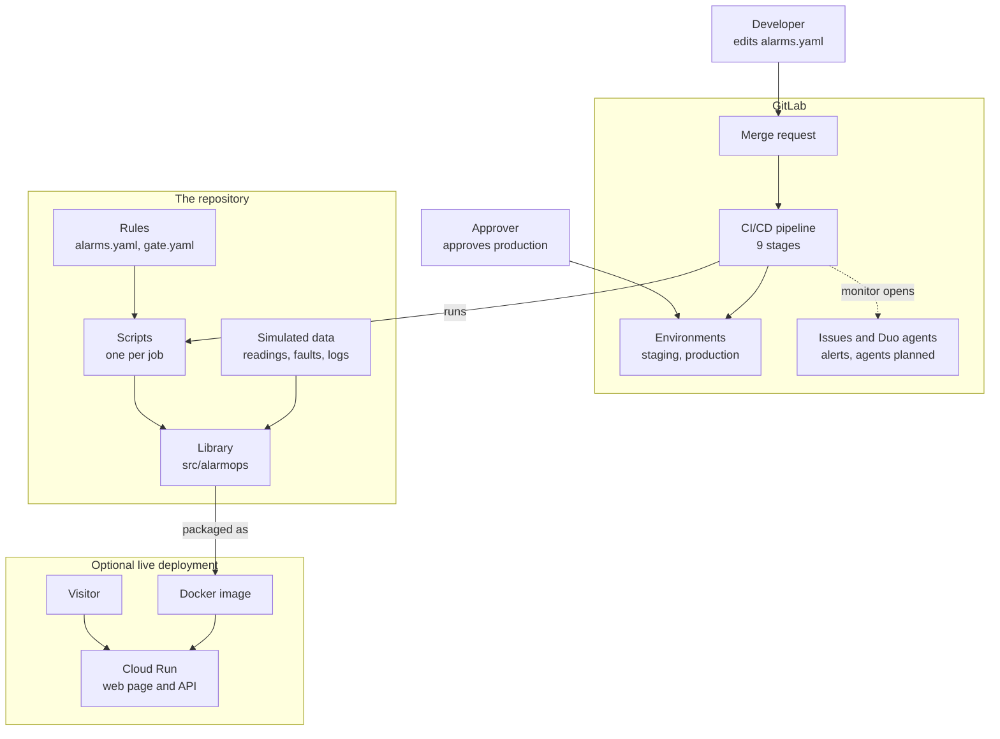

# AlarmOps

**Every change to an industrial alarm limit is measured before it ships, and a human approves only the final production step.**

AlarmOps is an agent-driven GitLab CI/CD pipeline that reviews, tests, scans, documents,
deploys and monitors changes to alarm-limit configuration. Built for the
GitLab Transcend "Life After Code" hackathon (Path A: Start Fresh, **Supervised** autonomy).

> **This is a simulation.** It reads simulated sensor data from CSV files. It does not
> connect to, or control, any real plant equipment.

## The problem

In a plant, an *alarm limit* is the value at which the control system alerts an operator
(for example, a high tank level). Limits get edited over time, and a bad edit is dangerous
in either direction: too wide and a real abnormal condition raises no alarm; too narrow and
operators are flooded with nuisance alarms and start ignoring them.

Alarm-management practice (ANSI/ISA-18.2, IEC 62682) expects alarm changes to go through
controlled management of change. In practice that review is manual, nobody measures what the
change does to detection, the evidence is gathered by hand, and nothing watches the alarm
rate after deployment.

## What AlarmOps does

For every merge request that changes `alarms.yaml`:

1. **Measures the change.** It replays a simulated, fault-labelled sensor dataset (spikes,
   drift, stuck readings) against the old and new rules and reports fault-detection rate and
   false-alarm count.
2. **Gates it.** A change that loses too much detection, or creates too many false alarms, is
   blocked. The measured result is posted on the merge request.
3. **Scans it.** Secret detection blocks hard-coded credentials.
4. **Documents it.** It generates a change record (what changed, measured effect, scan status,
   approval line) and an SBOM.
5. **Deploys it to staging and validates it.** Hash check, replay, and a service smoke test.
6. **Waits for a human** before production (the single approval gate).
7. **Monitors it.** A scheduled job watches the post-deploy alarm rate and opens an issue
   with a diagnosis when it drifts.

## Measured results

All numbers are produced by the replay harness on the committed dataset
(6,000 samples, 3 tags, 21 labelled faults), not typed in by hand.

| Change | What it does | Result |
|---|---|---|
| Baseline rules | Original limits | 21/21 faults detected, 0 false alarms |
| `demo-change-a` | Widens the tank `high` / `high_high` limits to 88 / 95 | **Blocked at review.** Detection 100% to 81.0% (17/21). Four tank faults no longer detected |
| `demo-change-b` | Adds a (fake) hard-coded credential | **Blocked at security.** GitLab Secret Detection reports 1 critical finding (AWS Access Key ID); merge blocked |
| `demo-change-c` | Tightens the tank limits to 75 / 88 | Passes every stage; **waits for human approval**. 21/21, 0 false alarms |
| Post-deploy monitor | Simulated drifting alarm log | Detects drift: `pump_pressure` 0.79 to 13.67 alarms/hour |

## Architecture



Everything inside "The repository" is simulation: no real plant connection. The Cloud Run part is optional
and only live once you deploy it (see "Google Cloud" below).

## Pipeline

```mermaid
flowchart LR
  MR["Merge request edits alarms.yaml"] --> PLAN["plan: validate rules"]
  PLAN --> REVIEW["review: replay old vs new, gate, MR comment"]
  REVIEW --> TEST["test: unit tests, replay floor"]
  TEST --> SEC["security: Secret Detection, secret_guard"]
  SEC --> COMP["compliance: change record, SBOM"]
  COMP --> STG["deploy_staging"]
  STG --> VAL["validate staging"]
  VAL --> HUMAN{{"Human approval"}}
  HUMAN --> PROD["production (default branch only)"]
  PROD --> MON["monitor: alarm-rate drift, opens issue"]
```



Merge-request pipelines run up to `validate`. The production approval exists only on the
default branch, so it cannot be reached from an unmerged change.

### GitLab lifecycle stages touched

| Lifecycle stage | AlarmOps job(s) |
|---|---|
| Plan | `validate_rules` (an issue-triage Duo flow is designed, not built) |
| Create | merge request review: `replay_review` gate, plus GitLab's built-in Duo Fix CI/CD Pipeline flow |
| Verify | `unit_tests`, `replay_test`, `validate_staging` |
| Package | `sbom` (CycloneDX), `Dockerfile`, optional `build_image` |
| Secure | GitLab Secret Detection, `secret_guard` |
| Release | `deploy_staging`, `deploy_production` (manual) |
| Configure | alarm rules as code (`alarms.yaml`, `gate.yaml`), `staging` / `production` environments |
| Monitor | `monitor_alarm_rate` (a monitoring-diagnosis Duo flow is designed, not built) |
| Govern | `change_record`, ISA-18.2 / IEC 62443 reference mapping, approval gate, audit trail |

## Where GitLab Duo Agent Platform is used

Duo Agent Platform is switched on in this project. What has actually run, and what is only designed:

| Flow | Trigger | What it does | Status |
|---|---|---|---|
| GitLab built-in Fix CI/CD Pipeline | "Fix pipeline with Duo" button on a failed pipeline (clicked by a person) | Read the failing replay_review job and the diff, explained that detection fell from 100% to 81.0%, and suggested restoring the old limits. The suggestion was deliberately not applied | Ran on merge request !1 (demo A) |
| Custom MR review flow | Flow service account assigned as reviewer | Explain the replay result and risk on the MR | Designed, not built |
| Custom issue triage flow | Mention in an issue | Classify change requests and label them | Designed, not built |
| Custom pipeline summary flow | Pipeline event | Summarise scan findings and failures | Designed, not built |
| Custom monitoring diagnosis flow | Mention on the monitoring issue | Explain an alarm-rate drift | Designed, not built |

The designs and draft prompts are in `docs/duo-agents.md`. Custom flows are created in the GitLab UI; `duo/flows/` holds only a placeholder, and no custom flow YAML is committed.
Execution settings for flows are in `.gitlab/duo/agent-config.yml`.

## Try it (no GitLab account needed)

Requires Python 3.11+ and git.

```bash
git clone <this repository> alarmops && cd alarmops
python -m venv .venv
source .venv/bin/activate              # Windows: .venv\Scripts\activate
pip install -r requirements-dev.txt && pip install -e .

python -m pytest -q                    # unit and end-to-end tests (about 45 s)
python scripts/make_demo_branches.py --force   # (re)creates demo-change-a / -b / -c from the current branch
python scripts/local_demo.py           # runs the pipeline on all three, prints a summary
python -m alarmops.web                 # web page with the interactive lab: http://localhost:8080
python scripts/local_pipeline.py       # runs it on your current branch
```

The demo branches are copies of `main`, so rebuild them with `--force` whenever `main` changes, and
wait for "Back on 'main'" before touching the folder (the runner switches branches).
On Windows PowerShell, set `$env:PYTHONPATH = "src"` instead of `PYTHONPATH=src`, or run `pip install -e .`.
Optional: `pip install cyclonedx-bom` enables the SBOM job locally.
Per-job logs are written to `out/local/`.

Other entry points:

```bash
python -m alarmops.replay --rules alarms.yaml            # measure any rules file
python scripts/compare_replay.py --base-ref main --head-rules alarms.yaml   # exit 1 = blocked
python scripts/monitor.py --log data/post_deploy_alarm_log_drift.csv
python data/generate_dataset.py                          # regenerate the (seeded) dataset
```

## Run it on GitLab

1. Create a public project, push all branches (`main` and the three `demo-change-*`).
2. Add a masked CI/CD variable `GITLAB_API_TOKEN` (project access token, `api` scope) so the
   pipeline can comment on merge requests and open monitoring issues.
3. Protect the `production` environment (Settings > CI/CD > Protected environments).
4. Open a merge request from each demo branch into `main`.
5. Optional: add a pipeline schedule for `monitor_alarm_rate`.

`.gitlab-ci.yml` runs on GitLab's shared runners. `demo-change-b` contains a deliberately
**fake** credential and must never be merged.

## Google Cloud (optional bonus: public live deployment)

The container serves a web page (`/`, a plain-English explanation built from measured results),
a JSON API (`/api/replay`) and a health check (`/healthz`). The page has a **"Try it yourself" lab**:
edit the tank limits and run the real replay and gate, scan pasted text for credentials, and run the
monitor on a healthy or drifting simulated log. The lab calls a fixed set of safe functions: it never
runs a shell, stores nothing, caps inputs and concurrency, and never echoes scanned text back.
A static copy of the page (no lab) is in [`docs/explainer.html`](docs/explainer.html).

Run it locally:

```bash
docker build -t alarmops:local .
docker run --rm -p 8080:8080 alarmops:local        # open http://localhost:8080
# no Docker:  PYTHONPATH=src python -m alarmops.web   (PORT=8080 by default)
```

Deploy to Cloud Run (you need your own Google Cloud project with billing; the free tier is enough):

```bash
gcloud auth login
gcloud services enable run.googleapis.com cloudbuild.googleapis.com artifactregistry.googleapis.com
export GCP_PROJECT_ID=<your-project-id> GCP_REGION=europe-west1
sh cloud/cloudrun_deploy.sh                        # prints the public URL and checks /healthz
```

In GitLab, the manual `deploy_cloud_run` job (after the production approval) does the same when
`GCP_PROJECT_ID`, `GCP_REGION` and a file-type `GCP_SA_KEY` CI variable are set. Never commit the key.
Status: the container and web app are tested locally; the Cloud Run deployment itself has not been
run from this repository yet. Put the public URL here once it is live: TODO.

## How the measurement works

- A labelled fault counts as **detected** if an alarm for that tag *starts* between the fault's
  start and its end plus 20 samples. An alarm *start* needs the value to stay beyond the limit
  for `delay_samples` samples; clearing needs the value to return inside the limit by the
  `deadband`.
- A **false alarm** is an alarm start that falls inside no fault window for its tag.
- Known limitation: if a nuisance alarm is already active when a fault begins, no new alarm
  starts, so that fault is scored as missed. This only appears at extreme limits.
- The gate thresholds in `gate.yaml` (90% minimum detection, at most 5 points of drop, at most
  3 false alarms, at most 2 added) are policy choices for this simulation, not an industry
  standard.
- The dataset is synthetic and seeded (`data/generate_dataset.py`). Results show how the gate
  behaves, not how any real plant would behave.

## Limits and honesty

- Simulation only. No real plant connection, no real operator workflow.
- Deployment is simulated: a "release" is `alarms.yaml` plus a hashed manifest, verified before
  promotion. The Google Cloud Run deployment code is included (`cloud/`), but it is only
  "live" once you have deployed it to your own Google Cloud project (see below).
- The ISA-18.2 / IEC 62443 table in each change record is a **reference mapping, not a
  certification**. Clause numbers are intentionally omitted.
- Scanner availability depends on the GitLab tier. Secret Detection is enabled;
  dependency and container scanning are left as commented-out includes.
- Tests do not depend on the live `alarms.yaml`, so valid limit changes do not break them.

## Repository layout

```
alarms.yaml, gate.yaml       rules under change control, and the gate thresholds
src/alarmops/                rules loader, alarm engine, replay harness, gate, deploy logic, web front
cloud/                       Google Cloud Run deploy script
docs/explainer.html          plain-English page (regenerate: python scripts/build_explainer.py)
scripts/                     CI job scripts, local pipeline runner, demo branch tooling
data/                        seeded dataset, labelled faults, simulated post-deploy logs
tests/                       unit and end-to-end tests (frozen baseline fixtures)
.gitlab-ci.yml               the pipeline
.gitlab/duo/, duo/flows/     Duo Agent Platform configuration
docs/duo-agents.md           flow designs, prompts, and setup steps
DEMO_SCRIPT.md               timed script for the demo video
SUBMISSION.md                Devpost text and the submission checklist
```

## How this was built

Written with AI assistance (Claude) for code and documentation, directed and reviewed by the
author. The behaviour described above is covered by tests and was run locally before pushing.

## License

MIT, copyright Anthony Afonughe, 2026. Agent configuration YAML files are part of the
submission and are covered by the same license and GitLab's Developer Certificate of Origin 1.1.
